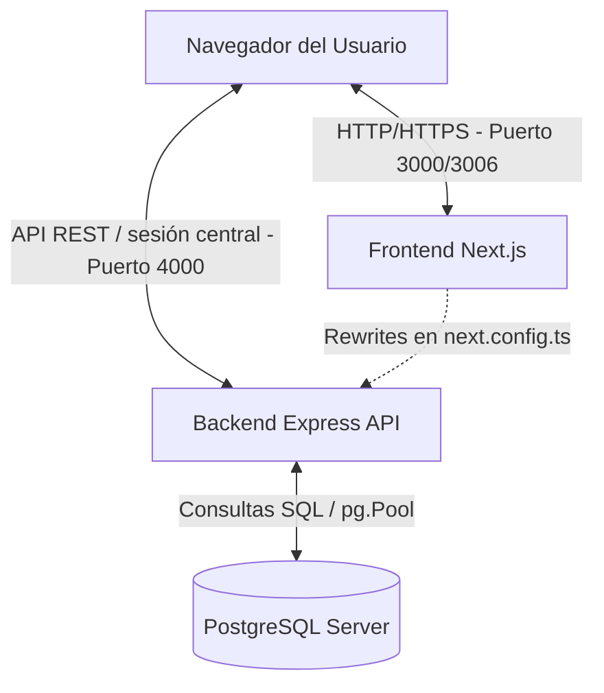

# Arquitectura Técnica - Tablero de Recursos y Empleo (COPA)

Este documento detalla la arquitectura de software, el flujo de comunicación y el diseño técnico del sistema para asegurar el correcto mantenimiento, escalabilidad y seguridad.

---

## 1. Visión General (High-Level Architecture)

El sistema está estructurado como una aplicación **SPA (Single Page Application)** moderna bajo una arquitectura desacoplada en dos componentes principales de Node.js:

1. **Frontend (Next.js)**: 
   - Procesa la interfaz de usuario en el lado del cliente (React/TypeScript).
   - Se comunica dinámicamente con la API REST para renderizar los datos frescos sin necesidad de compilaciones periódicas estáticas.
2. **Backend (Express API)**: 
   - Servidor Node.js ligero que expone las rutas RESTful en el puerto 4000.
   - Valida la sesión central, registra la telemetría de uso y realiza consultas analíticas sobre PostgreSQL.

---

## 2. Flujo de Comunicación y Configuración de Red

### A. Proxy Reverso y Enrutamiento (Rewrites)
Para simplificar la configuración del lado del cliente y evitar problemas de CORS (Cross-Origin Resource Sharing) en producción, el frontend de Next.js configura un sistema de **Rewrites** en su archivo de configuración [`next.config.ts`](file:///c:/Users/USER/Desktop/Codigos/Trabajo_IPECD/Copa/apps/web/next.config.ts):

- **Ruta de Base (basePath)**: `/copa`
- **Enrutamiento de API**: Cualquier petición hacia `/copa/copa-api/:path*` o `/copa-api/:path*` es reescrita internamente en el servidor hacia la URL del backend: `http://localhost:4000/:path*`.
- **Efecto**: El navegador realiza peticiones al mismo dominio y puerto del frontend, y Next.js actúa como proxy reverso transparente hacia el backend.

### B. Consumo de API Seguro (`fetchWithAuth`)
El frontend realiza peticiones HTTP asíncronas con [`fetchWithAuth`](../apps/web/src/lib/api.ts).
La sesión central se envía mediante cookie segura. Ante un **401 Unauthorized**,
el cliente limpia cualquier token heredado del navegador y redirige al login.

---

## 3. Autenticación y Autorización

El acceso se valida en `imi_identidad`. El login propio de Copa y el ingreso
desde el portal comparten la misma sesión central. El middleware
[`auth.js`](../apps/api/middleware/auth.js) consulta `/sso/me?audiencia=tablero`
en cada petición, obtiene el rango y los alcances de Copa y deniega sesiones
heredadas por JWT. `datos_tablero` conserva los datos y la telemetría de Copa,
sin almacenar contraseñas ni permisos de sus usuarios.

---

## 4. Telemetría y Registro de Auditoría

El sistema cuenta con un sistema de auditoría exhaustivo para registrar el uso del tablero:

### A. Auditoría Automática (Middleware)
El backend utiliza el middleware [`activityLogger`](file:///c:/Users/USER/Desktop/Codigos/Trabajo_IPECD/Copa/apps/api/middleware/logger.js) en todas las peticiones:
- Inyecta una función helper `req.logAction`.
- Permite a los endpoints de la API registrar interacciones de forma automática en la tabla `public.coparticipacion_registros`.
- Captura de forma segura:
  - Identificador de usuario (`id_usuario`).
  - Acción / Ruta solicitada (`GET /api/personal/masa-salarial`).
  - Dirección IP del cliente (`ip_cliente`).
  - Metadatos en formato JSON (parámetros de consulta, parámetros de ruta y cuerpo de peticiones POST/PUT).

### B. Telemetría de Interfaz de Usuario
Para las acciones que ocurren puramente en el cliente y no generan consultas a la base de datos (por ejemplo, alternar entre vistas, clics en filtros, descargas de reportes):
- El frontend utiliza el Hook personalizado [`useAnalytics`](file:///c:/Users/USER/Desktop/Codigos/Trabajo_IPECD/Copa/apps/web/src/hooks/useAnalytics.ts).
- Este hook realiza una petición POST hacia `/api/analytics/log`.
- Cuenta con lógica de **Deduplicación (dedupe)** de 1000 ms para evitar registros duplicados causados por clics múltiples rápidos o por el modo estricto de React.

---

## 5. Hosting y Control de Procesos (PM2)

En entornos de producción, la ejecución y estabilidad de ambas aplicaciones (Frontend y API) se controlan de forma centralizada con el administrador de procesos **PM2** mediante el archivo de configuración [`ecosystem.config.js`](file:///c:/Users/USER/Desktop/Codigos/Trabajo_IPECD/Copa/ecosystem.config.js):

- **`copa-web`** (Frontend):
  - Directorio de trabajo: `apps/web`
  - Comando: `npm start`
  - Puerto asignado: **3006**
- **`copa-api`** (Backend):
  - Directorio de trabajo: `apps/api`
  - Comando: `node index.js`
  - Puerto asignado: **4000**

PM2 se encarga de reiniciar las aplicaciones ante caídas del servidor, gestionar los registros de salida (`logs`) y facilitar los despliegues sin tiempo de inactividad.
